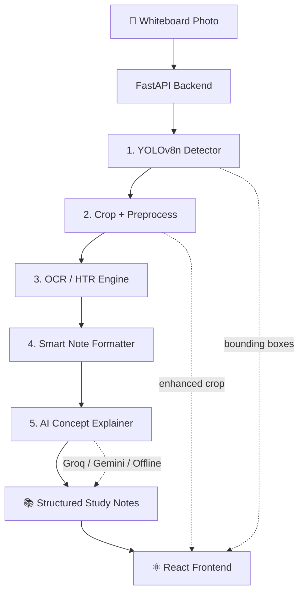

<div align="center">

# 🧠 BoardMind AI

### From whiteboard scribbles to smart, structured study notes.

An end-to-end computer-vision + OCR + LLM platform that detects a whiteboard in a classroom photo, cleans it up, reads the handwriting, and turns it into clean, organized notes.

[](https://www.python.org/)
[](https://fastapi.tiangolo.com/)
[](https://react.dev/)
[](https://www.typescriptlang.org/)
[](https://docs.ultralytics.com/)
[](https://pytorch.org/)
[](https://tailwindcss.com/)

**Frontend:** http://127.0.0.1:5174 &nbsp;•&nbsp; **API Docs:** http://127.0.0.1:8001/docs &nbsp;•&nbsp; **Health:** http://127.0.0.1:8001/api/health

</div>

---

## 📖 Overview

Classroom notes are often trapped in photos of messy whiteboards: skewed angles, glare, poor lighting, and rushed handwriting. **BoardMind AI** automates the entire conversion:

1. **Finds the whiteboard** with a custom-trained YOLOv8n detector.
2. **Crops and enhances** the board using perspective isolation, CLAHE contrast, and stroke filtering.
3. **Reads the handwriting** with a deep OCR/HTR engine and line segmentation.
4. **Structures the content** into headings, formulas, steps, and key terms.
5. **Explains the concept** using Groq, Gemini, or a fully offline academic synthesizer.
6. **Delivers a polished UI** for reviewing, editing, copying, and exporting notes.

Everything runs locally on CPU by default — no GPU required.

### 📊 Results at a glance

Held-out **test split** (177 images), champion model `exp1_aug_perspective_scale`:

| Metric | Score |
| :--- | ---: |
| Precision | **99.91%** |
| Recall | **100.00%** |
| F1 score | **99.96%** |
| mAP@50 | **99.50%** |
| mAP@50–95 | **91.70%** |
| Box-level accuracy (TP / (TP + FP + FN)) | **98.88%** |
| CPU latency (idle benchmark) | **29.08 ms/img** |
| Throughput (idle benchmark) | **34.4 FPS** |
| Model size | **6.17 MB** |
| Parameters / GFLOPs | **3.14 M / 8.7** |

> Metrics are on the untouched test split after model selection. See [Evaluation Metrics & Results](#-evaluation-metrics--results) for the full validation and test breakdown.

---

## ✨ Features

| | Feature |
| :--- | :--- |
| 🎯 | **Whiteboard detection** — custom YOLOv8n model with perspective-aware bounding boxes |
| 🖼️ | **Image preprocessing** — CLAHE contrast enhancement, bilateral filtering, wall/background rejection |
| ✍️ | **Handwriting recognition** — RapidOCR ONNX engine with multi-scale super-resolution and lexical correction |
| 🧩 | **Line segmentation** — Otsu thresholding + horizontal ink projection profiling |
| 🤖 | **AI concept explainer** — Groq (Llama 3.3 70B) → Gemini 1.5 Flash → offline synthesizer fallback |
| 📝 | **Smart note structuring** — titles, headings, formulas, numbered steps, and bulleted concepts |
| ⚡ | **Live processing timeline** — five-stage progress feedback in the UI |
| 🔍 | **Side-by-side review** — toggle between YOLO bounding boxes and the cropped/enhanced board |
| ✏️ | **Editable canvas** — fix OCR mistakes directly in the browser |
| 📤 | **One-click export** — copy notes, or download as Markdown (`.md`), plain text (`.txt`), or a paginated **A4 PDF** |
| 🩺 | **System diagnostics** — live model, hardware, and engine status via `/api/health` |

---

## 🏗️ Architecture



### Processing pipeline

```text
Upload
  └─► Detect whiteboard (YOLOv8n, CPU)
        └─► Crop primary region
              └─► Enhance (CLAHE + bilateral filter + stroke density)
                    └─► Segment lines (Otsu + projection profile)
                          └─► Recognize text (RapidOCR / DeepCRNN)
                                └─► Correct academic terms
                                      └─► Structure notes (Markdown)
                                            └─► Explain concepts (LLM or offline)
                                                  └─► Return notes + images + metadata
```

---

## 📊 Datasets

### 1. Whiteboard Detection Dataset

| Property | Value |
| :--- | :--- |
| Source | [Roboflow Universe — Whiteboard Dataset](https://universe.roboflow.com/university-of-peshawar-4qet5/whiteboard-dataset) |
| Workspace | University of Peshawar |
| Version | v1 (exported 13 May 2024) |
| License | **CC BY 4.0** |
| Images | **1,964** |
| Classes | **1** (`Whiteboard`) |
| Annotation format | YOLOv8 bounding boxes (5-value normalized `class cx cy w h`) |
| Image size | **640 × 640** (all images) |
| Unique source photos | **877** (Roboflow generated augmented variants) |
| Train / Valid / Test | **1,608 / 179 / 177** images (81.87% / 9.11% / 9.01%) |

**Dataset preprocessing applied by Roboflow**

- Auto-orientation of pixel data with EXIF-orientation stripping.
- Resize to **640 × 640** (stretch).

**Dataset augmentation applied by Roboflow** (to create up to 3 versions of each source image)

- 50% probability of horizontal flip.
- Equal probability of 90° rotation: none / clockwise / counter-clockwise.
- Random shear between **−15° and +15°** horizontally and vertically.
- Salt-and-pepper noise applied to **0%** of pixels (configured but inactive).

> The dataset is not committed to Git because of size. The YOLO-format directory structure (`train/`, `valid/`, `test/`) and `data.yaml` are expected under `datasets/whiteboard/`.

### 2. Handwriting Dataset (IAM)

Used for the optional DeepCRNN handwriting-recognition research path:

| Property | Value |
| :--- | :--- |
| Dataset | IAM Handwriting line crops (Parquet) |
| Total line samples | **10,373** |
| Train | **6,482** (62.49%) |
| Validation | **976** (9.41%) |
| Test | **2,915** (28.10%) |
| Columns | `text`, `image` (bytes / path) |
| Location | `datasets/handwriting/` (not committed) |

---

## 🧹 Dataset Audit & Cleaning

A full audit was run before training (`src/audit_dataset.py`) to verify file pairing, annotation integrity, duplicates, split leakage, image health, and bounding-box geometry.

### Integrity audit

| Check | Train | Valid | Test | Result |
| :--- | ---: | ---: | ---: | :--- |
| Images | 1,608 | 179 | 177 | ✅ |
| Label files | 1,608 | 179 | 177 | ✅ |
| Images without labels | 0 | 0 | 0 | ✅ |
| Labels without images | 0 | 0 | 0 | ✅ |
| Corrupted / unreadable images | 0 | 0 | 0 | ✅ |
| Invalid / corrupted labels | 0 | 0 | 0 | ✅ |
| Out-of-bounds coordinates | 0 | 0 | 0 | ✅ |
| Empty label files | 0 | 1 | 0 | ✅ treated as background |
| Annotation format | 5-value YOLO bbox | 5-value YOLO bbox | 5-value YOLO bbox | ✅ |
| Class distribution | `0: Whiteboard` | `0: Whiteboard` | `0: Whiteboard` | ✅ 1,963 boxes |

**Cleaning actions performed**

- Verified every image has a matching label and every label has a matching image.
- Validated class IDs, coordinate counts, finiteness, and normalized bounds (0–1).
- Confirmed all annotations are standard 5-value YOLO bounding boxes.
- Kept the single empty validation label as a valid **background** image.
- Removed stale Ultralytics `labels.cache` files before training so annotations were re-scanned.
- Ran MD5 hashing across all splits to detect exact duplicates.
- Ran Roboflow base-stem analysis to detect augmented variants of the same source photo leaking across splits.
- Audited bounding-box geometry to quantify dataset bias before choosing augmentations.

### Duplicate & leakage audit

| Check | Result |
| :--- | :--- |
| Exact identical image hashes | **0** |
| Cross-split exact duplicates | **0** |
| Intra-split exact duplicates | **0** |
| Unique base image stems | **877** |
| Base photos appearing in multiple splits | **3** (minor leakage risk) |

> The 3 cross-split base stems are a known limitation inherited from the Roboflow export. They represent a very small fraction of the 877 source photos and no exact duplicate images were found. They are documented here for transparency rather than silently ignored.

### Geometric bias analysis

| Split | Normalized area (min) | Median | Mean | Max | Aspect ratio (median) | Boxes > 30% image area |
| :--- | ---: | ---: | ---: | ---: | ---: | ---: |
| Train | 0.6432 | **0.9645** | 0.9477 | 1.0000 | 1.00 | **100%** |
| Valid | 0.6974 | **0.9817** | 0.9617 | 1.0000 | 1.00 | **100%** |
| Test | 0.6012 | **0.9787** | 0.9607 | 1.0000 | 1.00 | **100%** |

Every image contains exactly **one** whiteboard, and the board occupies a median of **96.5–98.2%** of the frame. This is a severe full-frame bias: a model can score highly by predicting a near-full-image box. The augmentation strategy was designed specifically to break this bias.

---

## 🏋️ Training Methodology & Algorithms

### Base model — YOLOv8n

| Property | Value |
| :--- | :--- |
| Architecture | Ultralytics **YOLOv8n** (nano detection) |
| Backbone | CSP-style CNN with C2f blocks |
| Neck | PAN-FPN multi-scale feature fusion |
| Head | Anchor-free, decoupled classification/regression head |
| Box regression | CIoU loss + Distribution Focal Loss (DFL) |
| Label assignment | Task-Aligned Assigner |
| Initialization | COCO-pretrained `yolov8n.pt` (transfer learning) |
| Parameters | **3,138,003** (3.14 M) |
| GFLOPs | **8.7** |
| Model size | **6.17 MB** |

### Training environment

| Component | Value |
| :--- | :--- |
| Hardware | Intel Core i9-13900H, 16 GB RAM, Windows |
| Device | **CPU** (`device="cpu"`) |
| Python | 3.11 |
| PyTorch | 2.15.0+cpu |
| Ultralytics | 8.4.204 |
| Input resolution | **416 × 416** |
| Data loading | `workers=0`, `cache=False` |
| Mixed precision | Disabled (`amp=False`) |
| Augmentation pipeline | Ultralytics built-in (mosaic, HSV, geometry, erasing) |

### Controlled experiments

Three controlled runs were recorded in `runs/whiteboard_optimization/experiment_registry.json`:

| Experiment | Role | Init from | Epochs | Batch | LR | Cosine LR | Warmup |
| :--- | :--- | :--- | ---: | ---: | ---: | :---: | ---: |
| `exp0_baseline_yolov8n` | Baseline | COCO `yolov8n.pt` | 3 | 2 | 0.01 | No | 3.0 |
| `exp1_aug_perspective_scale` | **Champion** | Baseline best | 3 | 8 | 0.002 | Yes | 1.0 |
| `exp2_aug_lighting_glare` | Photometric test | Baseline best | 3 | 8 | 0.002 | Yes | 1.0 |

All runs used `weight_decay=0.0005`, `lrf=0.01`, `imgsz=416`, `mosaic=1.0`, `mixup=0.0`, and `fliplr=0.5`.

**Augmentation differences**

| Augmentation | Baseline (exp0) | Geometric (exp1) | Photometric (exp2) |
| :--- | ---: | ---: | ---: |
| HSV hue | 0.015 | 0.015 | 0.015 |
| HSV saturation | 0.7 | 0.7 | **0.6** |
| HSV value / brightness | 0.4 | 0.4 | **0.6** |
| Rotation (`degrees`) | 0.0 | **10.0°** | 0.0 |
| Translation | 0.1 | **0.2** | 0.1 |
| Scale | 0.5 | **0.7** | 0.5 |
| Perspective | 0.0 | **0.001** | 0.0 |
| Random erasing | 0.4 | 0.2 | **0.5** |
| Mosaic | 1.0 | 1.0 | 1.0 |

### Algorithms & techniques used

- **Transfer learning / fine-tuning** — COCO-pretrained YOLOv8n fine-tuned on the single-class whiteboard dataset.
- **Anchor-free detection** — decoupled classification and box-regression heads.
- **Task-Aligned Assigner** — aligns positive samples with both classification and localization quality.
- **CIoU + DFL regression** — improved boundary localization and box uncertainty modeling.
- **PAN-FPN multi-scale fusion** — combines semantic and spatial features across scales.
- **Mosaic augmentation** — combines four images to expose the model to varied board scales and contexts.
- **Geometric augmentation** — rotation, translation, scaling, and perspective to simulate classroom camera angles and break full-frame bias.
- **Photometric augmentation** — HSV jitter and brightness variation to simulate lighting changes and glare.
- **Random erasing** — simulates occlusion, reflections, and objects blocking the board.
- **Cosine learning-rate scheduling + warmup** — stable fine-tuning on a short CPU-constrained schedule.
- **Weight decay regularization** — reduces overfitting on the small validation split.
- **Standardized model selection** — compare checkpoints on validation mAP/F1 and latency, export the champion, then evaluate once on the held-out test split.
- **Error analysis / failure mining** — inspect false positives, false negatives, low-confidence cases, and real-world photos.
- **Dataset auditing** — MD5 duplicate detection, base-stem leakage checks, annotation bounds validation, and bbox distribution analysis.

### Model selection protocol

1. Train and record every experiment in a central JSON registry.
2. Evaluate each checkpoint with the same validation split, image size, confidence, and IoU settings.
3. Compare precision, recall, F1, mAP@50, mAP@50–95, and CPU latency.
4. Export the selected champion to `models/whiteboard_detector_best.pt`.
5. Evaluate the champion on the untouched **test** split only after selection.

---

## 📈 Evaluation Metrics & Results

### Metric definitions

| Metric | Meaning |
| :--- | :--- |
| **Precision** | Of all predicted whiteboards, the fraction that are correct. |
| **Recall** | Of all real whiteboards, the fraction that were found. |
| **F1 score** | Harmonic mean of precision and recall. |
| **mAP@50** | Mean average precision at IoU ≥ 0.50. |
| **mAP@50–95** | Mean average precision averaged over IoU 0.50→0.95 (stricter localization). |
| **Box-level accuracy** | `TP / (TP + FP + FN)` from the confusion matrix. |
| **Latency / FPS** | End-to-end CPU inference time and throughput. |
| **Params / GFLOPs** | Model size and computational complexity. |

### Validation results (all experiments)

| Experiment | Precision | Recall | F1 | mAP@50 | mAP@50–95 | Latency | FPS |
| :--- | ---: | ---: | ---: | ---: | ---: | ---: | ---: |
| `exp0_baseline_yolov8n` | 0.9874 | 1.0000 | 0.9937 | 0.9942 | **0.9215** | 41.23 ms | 24.3 |
| **`exp1_aug_perspective_scale`** ⭐ | **0.9940** | **1.0000** | **0.9970** | **0.9949** | 0.9161 | **29.08 ms** | **34.4** |
| `exp2_aug_lighting_glare` | 0.9944 | 1.0000 | 0.9972 | 0.9900 | 0.9055 | 34.32 ms | 29.1 |

> Latency is from a 20-trial CPU benchmark. Validation-pipeline latency differs slightly from single-image benchmarking.

**Champion:** `exp1_aug_perspective_scale` — best precision, F1, and mAP@50, with the lowest measured CPU latency, while keeping mAP@50–95 within ~0.5 percentage points of the baseline. It is exported as `models/whiteboard_detector_best.pt`.

### Held-out test results (champion)

Evaluated on the untouched **177-image test split** at `imgsz=416`, `conf=0.25`, `iou=0.6`:

| Metric | Score |
| :--- | ---: |
| Precision | **0.9991 (99.91%)** |
| Recall | **1.0000 (100.00%)** |
| F1 score | **0.9996 (99.96%)** |
| mAP@50 | **0.9950 (99.50%)** |
| mAP@50–95 | **0.9170 (91.70%)** |
| True positives | **177** |
| False positives | **2** |
| False negatives | **0** |
| Box-level accuracy | **0.9888 (98.88%)** |
| Preprocess / inference / postprocess | 0.57 / 60.14 / 1.16 ms |
| End-to-end latency | 61.87 ms/img |
| Throughput | 16.2 FPS |
| Model size | 6.17 MB |

> The test run was performed while the local backend and frontend dev servers were also running, which reduced throughput. The idle benchmark for the same checkpoint is **29.08 ms/img (34.4 FPS)**.

### Confusion matrix (test split)

| Predicted ↓ / True → | Whiteboard | Background |
| :--- | ---: | ---: |
| **Whiteboard** | **177** | **2** |
| **Background** | **0** | **0** |

- **2 false positives**, **0 false negatives**.
- Box-level accuracy = `177 / (177 + 2 + 0) = 98.88%`.
- The model never missed a whiteboard in the test split.

### Error analysis & failure modes

| Failure mode | Description | Observed impact |
| :--- | :--- | :--- |
| False positives | Walls, projector screens, posters, or door frames predicted as whiteboards | 2 cases on the test split |
| False negatives | Board missed due to extreme angle, occlusion, or heavy clutter | 0 cases on the test split |
| Localization error | Box overlaps the board but boundary IoU < 0.75 | Reflected in the gap between mAP@50 (99.5%) and mAP@50–95 (91.7%) |
| Real-world domain shift | Classroom photos outside the Roboflow distribution | Qualitative test on `notebooks/board-srmap.jpg`; handled via geometric augmentation |

### Interpretation

- **mAP@50 = 99.5%** means the model almost always finds the board with a loose IoU threshold.
- **mAP@50–95 = 91.7%** is the stricter measure and shows that exact boundary localization is the main remaining source of error.
- **Recall = 100%** on the test split means no board was missed.
- The very high scores are partly explained by the dataset's full-frame bias (median board area ≈ 96.5–98.2%). The augmentation experiments were designed to reduce this bias, but real classroom photos remain harder than the benchmark suggests.

---

## 🧠 Handwriting Recognition (HTR)

### Production OCR engine

The deployed pipeline uses **RapidOCR** with ONNX Runtime — a deep CNN-RNN OCR engine — on CPU. It is wrapped by `backend/app/recognition/handwriting_recognizer.py`.

**HTR preprocessing and decoding**

- Multi-scale high-resolution super-resolution for small cursive handwriting.
- Otsu thresholding and horizontal ink-projection profiling for line segmentation.
- Academic lexical post-processing to correct common whiteboard OCR errors (e.g., `featukes` → `FEATURES`, `overfit` → `Avoid Overfitting`).
- Graceful fallback to a baseline interface if RapidOCR is unavailable.

### Optional DeepCRNN research architecture

`backend/app/recognition/deep_crnn.py` implements a deeper PyTorch HTR model for future fine-tuning:

| Component | Detail |
| :--- | :--- |
| Total parameters | **36,241,120 (36.2 M)** |
| Convolutional backbone | 6 residual blocks with Squeeze-and-Excitation (SE) channel attention |
| Pooling | Asymmetric max pooling (2×2, then 2×1) to preserve horizontal text resolution |
| Sequence modeling | 3-layer bidirectional LSTM (1024 units total) |
| Context layer | 8-head multi-head self-attention with residual connection |
| Head | LayerNorm → Linear(1024→512) → GELU → Linear(512→256) → GELU → Linear(256→96) |
| Loss | CTC loss (blank = 0) |
| Character classes | 96 (ASCII + blank) |
| Optimizer | AdamW, `lr=1e-3`, `weight_decay=1e-4` |
| Scheduler | `ReduceLROnPlateau` (factor 0.5, patience 2) |
| Regularization | Dropout 0.1–0.3, gradient clipping |

> The production system currently uses RapidOCR. The DeepCRNN path is implemented and its IAM training recipe is prepared, but no IAM accuracy benchmark is claimed in this repository yet. Handwriting transcription remains the hardest and least-benchmarked part of the pipeline.

---

## ⚙️ Inference Preprocessing & Note Structuring

### Image preprocessing (backend)

After YOLO detection, the primary board is cropped and enhanced by `backend/app/processing/image_preprocessor.py`:

1. **Crop with 2% padding** so writing near the board border is not clipped.
2. **Bilateral filter** (`d=5`, `sigmaColor=50`, `sigmaSpace=50`) for edge-preserving denoising.
3. **CLAHE in LAB space** (`clipLimit=3.0`, `tileGridSize=8×8`) to boost faint dry-erase marker contrast.
4. **Morphological closing** (2×2 rectangular kernel) to reconnect broken marker strokes.
5. **Otsu inverse thresholding** on grayscale to measure **ink stroke density**.
6. Convert back to RGB and pass the enhanced crop to the OCR/HTR engine.

If no whiteboard is detected, the full image is processed and a warning is returned to the client.

### Smart note structuring

`backend/app/processing/text_formatter.py` is a rule-based formatter that produces:

- Main title (or topic hint).
- Headings and topics.
- Bulleted core concepts.
- Numbered procedural steps.
- Definitions.
- Formulas, equations, and key terms.
- Clean GitHub-flavored Markdown.

It preserves the recognized text and does not invent facts. The AI explanation layer is separate and explicitly labeled by engine.

### AI concept explanation

Priority order with graceful fallback:

1. **Groq** — Llama 3.3 70B (fast, detailed academic explanations).
2. **Google Gemini** — 1.5 Flash (multimodal vision context).
3. **BoardMind Deep Academic Synthesizer** — 100% offline, CPU-only.

---

## 🧰 Tech Stack

| Layer | Technologies |
| :--- | :--- |
| **Frontend** | React 19, TypeScript, Vite 8, Tailwind CSS v4, lucide-react, marked, KaTeX, html2canvas-pro, jsPDF |
| **Backend** | FastAPI, Uvicorn, Pydantic v2, Python 3.11 |
| **Vision** | Ultralytics YOLOv8n, PyTorch (CPU), OpenCV, Pillow, NumPy |
| **OCR / HTR** | RapidOCR (ONNX Runtime), optional PyTorch DeepCRNN |
| **AI Layer** | Groq (Llama 3.3 70B), Google Gemini 1.5 Flash, offline synthesizer |
| **Tooling** | Experiment registry, audit scripts, evaluation scripts, Git, npm |

---

## 📂 Project Structure

```text
BoardMindAI/
├── backend/
│   ├── app/
│   │   ├── api/                    # REST endpoints
│   │   │   ├── health.py           # GET  /api/health
│   │   │   ├── detection.py        # POST /api/detect
│   │   │   ├── recognition.py      # POST /api/extract-text
│   │   │   ├── notes.py            # POST /api/generate-notes
│   │   │   └── process.py          # POST /api/process
│   │   ├── detection/
│   │   │   └── whiteboard_detector.py   # YOLOv8n singleton service
│   │   ├── recognition/
│   │   │   ├── handwriting_recognizer.py # OCR/HTR engine + line segmentation
│   │   │   └── deep_crnn.py              # Optional PyTorch CRNN architecture
│   │   ├── processing/
│   │   │   ├── image_preprocessor.py     # CLAHE, cropping, stroke filtering
│   │   │   ├── text_formatter.py         # Smart note structuring
│   │   │   └── ai_explainer.py           # Groq / Gemini / offline explainer
│   │   ├── services/
│   │   │   └── pipeline_service.py       # End-to-end orchestrator
│   │   ├── schemas/
│   │   │   └── models.py                 # Pydantic request/response models
│   │   └── main.py                       # FastAPI entrypoint + lifespan loader
│   ├── requirements.txt
│   └── test_backend.py
├── frontend/
│   ├── src/
│   │   ├── components/                   # Header, uploader, timeline, viewer, modal
│   │   ├── services/api.ts               # Typed API client
│   │   ├── types/index.ts                # TypeScript interfaces
│   │   ├── App.tsx
│   │   └── index.css
│   ├── package.json
│   └── vite.config.ts
├── models/
│   └── whiteboard_detector_best.pt       # Champion YOLOv8n checkpoint
├── notebooks/                            # Research, training & evaluation notebooks
│   ├── 01_dataset_exploration.ipynb
│   ├── 02_whiteboard_annotation_exploration.ipynb
│   ├── 03_whiteboard_dataset_quality_check.ipynb
│   ├── 04_whiteboard_model_training.ipynb
│   ├── 05_whiteboard_model_experiments.ipynb
│   ├── 06_whiteboard_augmentation_experiments.ipynb
│   ├── 07_whiteboard_error_analysis.ipynb
│   ├── 08_whiteboard_final_evaluation.ipynb
│   └── 09_handwriting_deep_crnn_training.ipynb
├── src/                                  # Audit, training, evaluation & error-analysis scripts
│   ├── audit_dataset.py
│   ├── train_experiment.py
│   ├── evaluate_model.py
│   ├── error_analysis.py
│   ├── run_experiments_pipeline.py
│   └── run_phase3_augmentations.py
├── .env.example
└── README.md
```

> `datasets/` and `runs/` are intentionally excluded from Git because of size. They are reproducible from the notebooks and scripts in `src/`.

---

## 🚀 Quick Start

### Prerequisites

| Tool | Version |
| :--- | :--- |
| Python | 3.10+ (3.11 recommended) |
| Node.js | 18+ |
| npm | 9+ |
| Git | Any recent version |

> CPU-only PyTorch is sufficient. No CUDA setup is required.

### 1. Clone the repository

```powershell
git clone https://github.com/RohitChintalapudi/Boardmind-AI.git
cd Boardmind-AI
```

### 2. Set up the backend

```powershell
# Create and activate a virtual environment
python -m venv .venv
.\.venv\Scripts\Activate.ps1

# Install dependencies
pip install -r backend/requirements.txt

# Optional: full OCR + AI engine support
pip install rapidocr-onnxruntime python-dotenv groq google-generativeai

# Create your local environment file
Copy-Item .env.example .env
```

### 3. Start the API

```powershell
uvicorn backend.app.main:app --host 127.0.0.1 --port 8001 --reload
```

| Resource | URL |
| :--- | :--- |
| Swagger UI | http://127.0.0.1:8001/docs |
| ReDoc | http://127.0.0.1:8001/redoc |
| Health check | http://127.0.0.1:8001/api/health |

The YOLO detector and OCR engine are loaded once at startup.

### 4. Start the frontend

In a second terminal:

```powershell
cd frontend
npm install
npm run dev
```

Open **http://127.0.0.1:5174**.

> The frontend expects the API on port **8001** (see `frontend/src/services/api.ts`). If you change the backend port, update that file too.

---

## ⚙️ Configuration

Create a `.env` file in the project root (copy `.env.example`). The file is git-ignored.

| Variable | Required | Purpose |
| :--- | :---: | :--- |
| `GROQ_API_KEY` | Optional | Enables fast Llama 3.3 70B academic explanations |
| `GEMINI_API_KEY` | Optional | Enables Gemini 1.5 Flash multimodal explanations |

Without any keys, BoardMind AI still works fully offline using the built-in **Deep Academic Synthesizer**. Get a free Groq key at [console.groq.com/keys](https://console.groq.com/keys).

---

## 🔌 API Reference

Base URL: `http://127.0.0.1:8001`

| Method | Endpoint | Body | Description |
| :--- | :--- | :--- | :--- |
| `GET` | `/api/health` | — | Model, hardware, and engine diagnostics |
| `POST` | `/api/detect` | `multipart/form-data` (`file`) | Detect whiteboards and return bounding boxes |
| `POST` | `/api/extract-text` | `multipart/form-data` (`file`) | Run OCR/HTR and return recognized lines |
| `POST` | `/api/generate-notes` | JSON (`raw_text`, `topic_hint?`, `api_key?`) | Structure text into study notes |
| `POST` | `/api/process` | `multipart/form-data` (`file`, `topic_hint?`, `conf_threshold?`, `api_key?`) | Full end-to-end pipeline |

**Limits:** JPEG, PNG, or WEBP up to **20 MB**.

### Full pipeline example

```powershell
curl.exe -X POST "http://127.0.0.1:8001/api/process" `
  -F "file=@test_user_wb.jpg" `
  -F "topic_hint=Machine Learning"
```

### Notes-only example

```powershell
curl.exe -X POST "http://127.0.0.1:8001/api/generate-notes" `
  -H "Content-Type: application/json" `
  -d '{\"raw_text\":\"Supervised learning uses labeled data\",\"topic_hint\":\"Machine Learning\"}'
```

### Health response (abridged)

```json
{
  "status": "healthy",
  "whiteboard_detector": {
    "loaded": true,
    "device": "cpu",
    "classes": { "0": "Whiteboard" }
  },
  "handwriting_recognizer": {
    "engine": "RapidOCR (ONNX Deep CNN-RNN Engine)",
    "status": "ready"
  },
  "hardware": {
    "os": "Windows",
    "cpu_count": 20,
    "ram_total_gb": 31.7
  }
}
```

---

## 🧪 Testing

Run the backend service test suite in-process:

```powershell
.\.venv\Scripts\python.exe backend\test_backend.py
```

The suite exercises the health endpoint, detector, recognizer, note generation, and the full pipeline. For API-level testing, use the Swagger UI at `/docs`.

To reproduce the model audit and metrics:

```powershell
# Dataset audit, duplicates, leakage, bbox distribution
.\.venv\Scripts\python.exe src\audit_dataset.py

# Standardized evaluation of a checkpoint
.\.venv\Scripts\python.exe src\evaluate_model.py

# Failure-case mining
.\.venv\Scripts\python.exe src\error_analysis.py
```

---

## 🛠️ Troubleshooting

| Symptom | Fix |
| :--- | :--- |
| `WinError 10013` when starting Uvicorn | The port is reserved or already in use. Try another port: `--port 8011`, then update `frontend/src/services/api.ts`. |
| `No trained whiteboard detection checkpoint found` | Confirm `models/whiteboard_detector_best.pt` exists and run commands from the project root. |
| Frontend shows "Cannot connect to backend" | Ensure the API is running on port **8001** and matches `API_BASE_URL` in `frontend/src/services/api.ts`. |
| First request is slow | Models load at startup; the first inference also warms up ONNX/PyTorch caches. |
| OCR quality is poor | Use brighter, glare-free photos and pass a `topic_hint` to improve note reconstruction. |
| `ModuleNotFoundError: rapidocr_onnxruntime` | Install optional engines: `pip install rapidocr-onnxruntime`. |
| PDF export fails with `unsupported color function "oklch"` | Fixed in the current code by using `html2canvas-pro`. If you see it, reinstall frontend dependencies (`npm install`) so the old `html2pdf.js` bundle is gone. |
| PDF export button does nothing | Check the browser console. The current implementation renders the notes with `html2canvas-pro` and paginates them with `jsPDF`, so no print dialog or popup permission is required. |

---

## ⚠️ Limitations & Notes

- **Dataset bias:** Boards occupy a median of 96.5–98.2% of the image, and every image has exactly one board. High benchmark scores partly reflect this full-frame bias.
- **Small test split:** The held-out test set contains 177 images. Confidence intervals on the metrics are therefore relatively wide.
- **Minor split leakage:** 3 of 877 source-photo stems appear in more than one split. No exact duplicate images were found.
- **Short training schedule:** Each experiment trained for only 3 epochs because training was CPU-only. Longer schedules may improve boundary localization.
- **Handwriting is the hardest stage:** The production OCR engine is general-purpose RapidOCR, not a classroom-handwriting-specific model. DeepCRNN is implemented but not yet benchmarked on IAM in this repository.
- **Latency varies with load:** The idle benchmark is 29.08 ms/img (34.4 FPS); the test run under concurrent local services measured 61.87 ms/img (16.2 FPS).
- **Metrics are dataset-specific:** Validation and test numbers come from the Roboflow whiteboard distribution. Real classroom photos with extreme angles, occlusion, or unusual board types may perform worse.

---

## 🗺️ Roadmap

- [x] Custom YOLOv8n whiteboard detector
- [x] Dataset audit, duplicate/leakage analysis, and geometric-bias study
- [x] Controlled geometric and photometric augmentation experiments
- [x] Standardized precision / recall / F1 / mAP / latency evaluation
- [x] CPU preprocessing and enhancement pipeline
- [x] OCR/HTR with line segmentation and lexical correction
- [x] Smart Markdown note structuring
- [x] Groq / Gemini / offline concept explanation
- [x] React review, editing, and export UI
- [ ] Fine-tune the DeepCRNN on IAM and benchmark CER/WER
- [ ] Collect and annotate real classroom photos for domain adaptation
- [ ] Multi-page whiteboard sessions
- [ ] Diagram and equation reconstruction
- [ ] Docker Compose one-command deployment

---

## 🤝 Contributing

Contributions are welcome!

1. Fork the repository.
2. Create a feature branch: `git checkout -b feature/your-idea`.
3. Commit your changes: `git commit -m "feat: add your idea"`.
4. Push and open a Pull Request.

For bugs or feature requests, open an issue with a sample image and the relevant API response.

---

## 🙏 Acknowledgements

- [Ultralytics YOLOv8](https://github.com/ultralytics/ultralytics) for the detection framework.
- [RapidOCR](https://github.com/RapidAI/RapidOCR) for the ONNX OCR engine.
- [FastAPI](https://fastapi.tiangolo.com/) and [React](https://react.dev/) for the application stack.
- [Groq](https://groq.com/) and [Google Gemini](https://ai.google.dev/) for optional LLM explanations.
- The Roboflow **Whiteboard Dataset** (University of Peshawar, CC BY 4.0) and the **IAM Handwriting Dataset** for research and evaluation.

---

<div align="center">

**Built for classrooms, powered by computer vision.**

If BoardMind AI helped you, consider giving the repo a ⭐.

</div>
